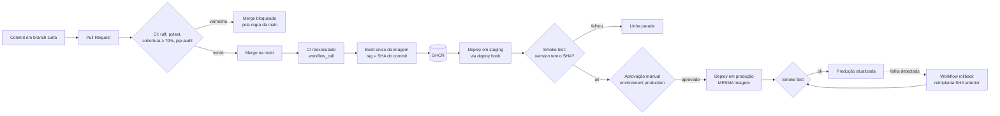

# Café com Deploy ☕


| Ambiente | URL | Rotas de verificação |
| --- | --- | --- |
| Staging | https://cafe-staging-nicolas.onrender.com | [/health](https://cafe-staging-nicolas.onrender.com/health) · [/version](https://cafe-staging-nicolas.onrender.com/version) · [/cafes](https://cafe-staging-nicolas.onrender.com/cafes) |
| Produção | https://cafe-production-nicolas.onrender.com | [/health](https://cafe-production-nicolas.onrender.com/health) · [/version](https://cafe-production-nicolas.onrender.com/version) · [/cafes](https://cafe-production-nicolas.onrender.com/cafes) |

API de cardápio da Café com Deploy (FastAPI + PostgreSQL) entregue por um pipeline completo de CI/CD.
No plano gratuito do Render o serviço "dorme" após inatividade: a primeira requisição pode levar até 1 minuto.

**Stack:** Python · FastAPI · SQLAlchemy · Alembic · pytest · Docker · GitHub Actions · GHCR · Render · Neon (PostgreSQL)

```bash
# rodar localmente (API + Postgres)
docker compose up --build
curl http://localhost:8000/cafes

# testes
pip install -r requirements.txt -r requirements-dev.txt
pytest --cov=app
```

---

# Relatório de Voo ✈️

## 1. Selos e ambientes

Os selos no topo mostram o estado atual do CI (`ci.yml`) e do pipeline de implantação (`cd.yml`) na `main`. Staging e produção são dois serviços independentes no Render, cada um com seu próprio banco no Neon, rodando a **mesma imagem Docker**.

## 2. Diagrama do pipeline



Cada imagem é construída **uma única vez** e promovida entre ambientes; só a configuração (variáveis de ambiente e secrets do GitHub Environment) muda.

## 3. Diagnóstico: antipadrões eliminados

Humble e Farley (*Entrega Contínua*, 2014) defendem três princípios: automatizar quase tudo, manter tudo sob controle de versão e "se dói, faça com mais frequência". A tabela mostra como cada antipadrão da crise da Café com Deploy foi substituído por uma prática verificável neste repositório.

| Antipadrão (sexta às 17h) | Prática adotada | Onde está a evidência |
| --- | --- | --- |
| Arquivos copiados via FTP direto para o servidor | Pipeline automatizado disparado pelo merge na `main` | [`.github/workflows/cd.yml`](.github/workflows/cd.yml) |
| Nenhum registro de qual versão estava rodando | Imagem com tag do SHA do commit; rota `/version` devolve o SHA em execução | `cd.yml` (job `build`), `app/main.py` |
| Código entrando sem revisão nem teste | `main` protegida: PR obrigatório + check `qualidade` verde | Ruleset `protege-main`; PR [#4](https://github.com/NicolasTomaschewski/cafe-com-deploy-nicolas/pull/4) barrado pelo CI |
| Preços zerados por bug não detectado | Testes unitários da regra de desconto + testes de integração da API + quality gate de cobertura | `tests/`, `ci.yml` |
| `ALTER TABLE` manual em produção | Migrations versionadas com Alembic, aplicadas pelo container a cada deploy | `migrations/versions/`, `CMD` do `Dockerfile` |
| "Funciona na minha máquina" | Container Docker multi-stage, mesmo artefato em todos os ambientes | `Dockerfile`, `docker-compose.yml` |
| Testar em ambiente parecido com produção só no fim | Staging recebe a mesma imagem antes da produção, com smoke test | Job `staging` do `cd.yml` |
| Configuração de ambientes feita à mão | Variáveis de ambiente (Twelve-Factor) e GitHub Environments com secrets próprios | `.env.example`, Settings → Environments |
| Senha do banco commitada | Credenciais apenas no Render e nos secrets do GitHub; `.env` no `.gitignore` | `.gitignore`, `.env.example` |
| Dependências "na última versão" | Versões fixadas com `==`, Dependabot semanal e `pip-audit` no CI | `requirements*.txt`, `.github/dependabot.yml` |
| Fim de semana inteiro fora do ar | Rollback em um clique para a imagem estável anterior | [`.github/workflows/rollback.yml`](.github/workflows/rollback.yml) |

## 4. Estratégia de testes

Seguindo a pirâmide de Mike Cohn, a base tem testes rápidos e o topo, poucos testes que verificam o sistema implantado.

| Camada | Quantidade | O que verifica | Onde |
| --- | --- | --- | --- |
| Smoke (pós-deploy) | 3 | `/version` responde com o SHA esperado após deploy em staging, em produção e após rollback | `cd.yml`, `rollback.yml` |
| Integração (API + banco) | 11 | Rotas `/health`, `/version`, CRUD de cafés, 404, nome duplicado (409), validação de preço (422), cálculo de preço com desconto, desconto inválido (400) e campo `origem` | `tests/test_api.py` |
| Unitários | 4 | Regra de negócio `preco_com_desconto` (casos válidos parametrizados e desconto acima do máximo) | `tests/test_unit.py` |

- **Total automatizado no CI:** 15 testes em duas camadas.
- **Cobertura:** 100% do pacote `app` (`pytest --cov=app`); o quality gate reprova abaixo de 70% (`--cov-fail-under=70`).
- **Isolamento:** os testes de integração usam um banco SQLite descartável criado pelo `conftest.py` a cada teste; **nunca** apontam para staging ou produção. A variável `TEST_DATABASE_URL` permite rodá-los contra PostgreSQL.
- **Evidência de que o gate funciona:** o PR [#4](https://github.com/NicolasTomaschewski/cafe-com-deploy-nicolas/pull/4) elevou o desconto máximo para 100%; o teste `test_desconto_acima_do_maximo` falhou, o check obrigatório ficou vermelho e o merge foi bloqueado.

## 5. Gerência de dados

| # | Revisão | Tipo | O que faz |
| --- | --- | --- | --- |
| 1 | `718ca2554f87` | Esquema | Cria a tabela `cafes` (`id`, `nome` único, `preco`) |
| 2 | `adf71a1b6b9d` | Seed | Insere o cardápio inicial com 5 cafés via `op.bulk_insert` |
| 3 | `2db963af808b` | Evolução pós-produção | Adiciona a coluna `origem` com valor padrão e preenche os cafés existentes |

As migrations são aplicadas **automaticamente** pelo container (`alembic upgrade head` no `CMD` do Dockerfile) a cada deploy. Staging (`cafe_staging`) e produção (`cafe_production`) usam bancos distintos no Neon.

### Migration 3 e o padrão expandir e contrair

A Migration 3 foi criada **depois** do primeiro deploy em produção (v1.0.0) e publicada na [v1.1.0](https://github.com/NicolasTomaschewski/cafe-com-deploy-nicolas/releases/tag/v1.1.0).

- **Expandir:** `op.add_column` cria `origem` como `NOT NULL` com `server_default='Não informada'`. Linhas existentes recebem o padrão; nada é removido ou renomeado.
- **Migrar:** dois `UPDATE` preenchem a origem real do cardápio (Cerrado Mineiro e Chapada Diamantina).
- **Compatibilidade:** durante o deploy, a versão anterior da API continuou funcionando com o esquema novo: ela simplesmente ignora a coluna, e seus `INSERT` recebem o valor padrão.
- **Contrair:** qualquer remoção ou renomeação ficaria para uma versão futura, quando nenhuma versão em uso dependesse do formato antigo. Por isso o rollback da aplicação não exige perda de dados.
- **Reversível:** o `downgrade()` remove a coluna; testado localmente com `alembic downgrade -1`, preservando os 5 cafés.
- **Dados preservados:** após o deploy, `/cafes` em staging e produção listou os mesmos registros, agora com `origem`.

**Lição aprendida:** como o container roda `alembic upgrade head` ao iniciar, uma imagem anterior à Migration 3 não reconhece a revisão gravada no banco e não sobe. Rollbacks são seguros apenas entre versões que conhecem as mesmas migrations. A evolução natural é separar a etapa de migration do start da aplicação, rodando-a como job próprio do pipeline.

## 6. Métricas DORA

Calculadas a partir do histórico real do repositório pelo script [`scripts/dora.py`](scripts/dora.py), que consulta a API do GitHub (execuções do `cd.yml` e do `rollback.yml`). Para reproduzir: `python scripts/dora.py`.

| SHA | Início da mudança (1º commit do PR) | Em produção | Lead time |
| --- | --- | --- | --- |
| `4736b36` | 15/10 22:27 UTC | 15/10 23:04 UTC | 36min28s |
| `02398bc` | 15/10 23:04 UTC | 15/10 23:11 UTC | 6min34s |
| `342b40c` | 15/10 23:36 UTC | 15/10 23:40 UTC | 4min06s |

| Métrica DORA | Valor no projeto | Como foi medida |
| --- | --- | --- |
| Frequência de deploy | 3 deploys em produção em 1 dia (15/10/2026) | Jobs `production` concluídos com sucesso no `cd.yml` |
| Lead time de mudanças | 15min42s em média (mínimo 4min06s) | Do primeiro commit do PR até o fim do job `production` |
| Taxa de falha de mudanças | 0% | Nenhum deploy precisou de correção ou rollback real; os rollbacks executados foram ensaios |
| Tempo de recuperação | 2min22s em média (mínimo 2min12s), em 2 rollbacks | Duração total do run de rollback, incluindo a aprovação |

Versões que passaram por produção:

| Versão | SHA | Origem |
| --- | --- | --- |
| A | `4736b36` | PR [#10](https://github.com/NicolasTomaschewski/cafe-com-deploy-nicolas/pull/10): pipeline de CD e rollback |
| B — v1.0.0 | `02398bc` | PR [#11](https://github.com/NicolasTomaschewski/cafe-com-deploy-nicolas/pull/11): selos e links |
| C — v1.1.0 | `342b40c` | PR [#12](https://github.com/NicolasTomaschewski/cafe-com-deploy-nicolas/pull/12): Migration 3 |
| D | XXXXXXX | Este PR (Relatório de Voo) |

Observações:

- O **primeiro run** do `cd` falhou no job `staging` porque os secrets do ambiente ainda não existiam. Foi uma falha de configuração do pipeline, não de uma mudança, e não entra na taxa de falha. Após configurar os Environments, o mesmo run foi reexecutado com sucesso.
- O lead time inclui o tempo de espera pela aprovação manual, que é o principal componente do tempo total.
- Os rollbacks foram exercícios: produção voltou para a versão anterior e, depois, para a mais recente. Por isso o script, que conta rollbacks como falhas, mostra 67% (2 ÷ 3); a taxa real de mudanças que causaram falha é 0%.
- O lead time de `4736b36` (36min28s) inclui a configuração inicial dos ambientes no Render e no GitHub; com o pipeline pronto, os deploys seguintes levaram entre 4 e 7 minutos.

## 7. Reflexão: implantação contínua?

**Recomendação: ainda não. A Café com Deploy deve manter a entrega contínua com aprovação manual agora e migrar para implantação contínua quando cumprir condições objetivas.**

A favor de remover a aprovação:

- O pipeline já constrói um único artefato, testa e valida com smoke test em staging; a aprovação humana acrescenta pouco à verificação técnica e é a maior parcela do lead time.
- Forsgren, Humble e Kim (*Accelerate*, 2018) mostram que lotes menores e deploys frequentes reduzem a taxa de falha e o tempo de recuperação.
- O rollback reimplanta a imagem anterior em minutos, o que limita o custo de um erro.

Contra, por enquanto:

- Não há testes ponta a ponta que exercitem os fluxos do app e dos totens; os smoke tests só confirmam que a versão certa subiu.
- Não há monitoramento nem alertas em produção: um erro só seria percebido por clientes.
- A API calcula preços: um bug em produção tem impacto financeiro direto, como na própria crise de sexta-feira.
- O rollback tem uma limitação conhecida com migrations (seção 5).

Condições para remover a aprovação manual:

1. Testes E2E automatizados contra staging cobrindo os fluxos de compra.
2. Monitoramento com alerta de taxa de erro e latência em produção.
3. Rollback automático quando o smoke test ou os alertas falharem.
4. Migrations desacopladas do start do container, permitindo rollback entre quaisquer versões.
5. Feature flags para liberar funcionalidades de forma gradual.

## 8. Integrantes

| Nome | Matrícula | GitHub | Papéis |
| --- | --- | --- | --- |
| Nicolas Tomaschewski | 82601955 | [@NicolasTomaschewski](https://github.com/NicolasTomaschewski) | Release Manager, Guardião dos Testes, Engenheiro de Plataforma, DBA e Documentador (trabalho individual) |

---

## Conquistas desbloqueadas 🏅

| Conquista | Critério | Evidência |
| --- | --- | --- |
| 📊 Painel DORA | 8 | Métricas calculadas automaticamente por [`scripts/dora.py`](scripts/dora.py) a partir da API do GitHub |

Práticas além do mínimo:

- `rollback.yml` com `permissions: contents: read` e smoke test que confirma a versão restaurada.
- `docker-compose.yml` com healthcheck do Postgres antes de subir a API.
- Ambiente `production` restrito à branch `main`, com revisor obrigatório.
- Dependabot tratado com critério: PRs de actions mergeados após CI verde.

## Decisões e lições registradas

- **Paridade de versão do Python:** o PR [#9](https://github.com/NicolasTomaschewski/cafe-com-deploy-nicolas/pull/9) do Dependabot atualizou a imagem base para `python:3.14-slim`, enquanto o CI continuava testando em Python 3.12. A divergência foi identificada na revisão do relatório e corrigida alinhando o `ci.yml` à versão da imagem, para que o ambiente testado seja o mesmo do implantado.
- **Prevent self-review:** em equipe, impedir que quem disparou o deploy o aprove é uma boa prática; neste trabalho individual a opção precisou ser desligada.